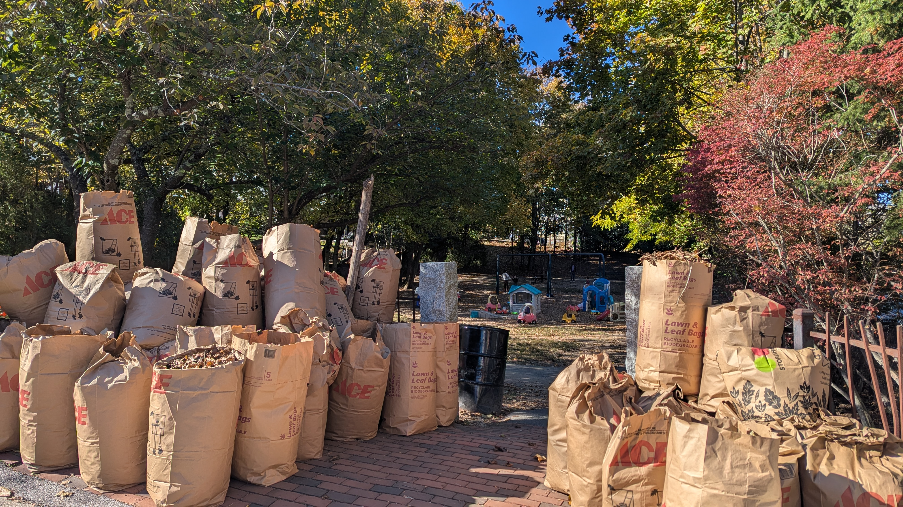
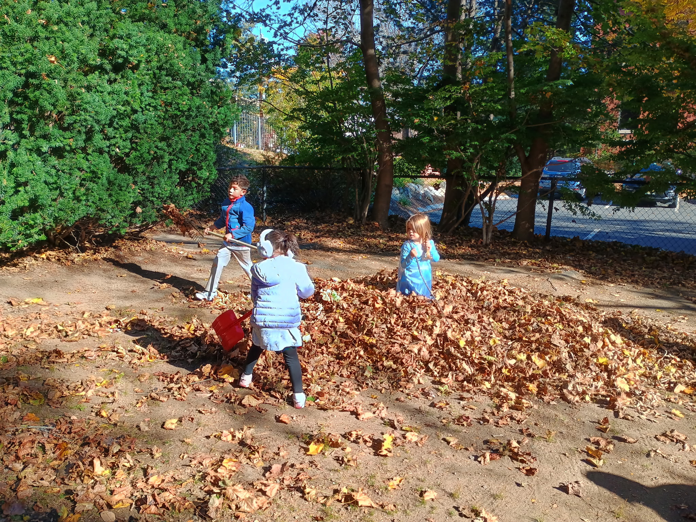
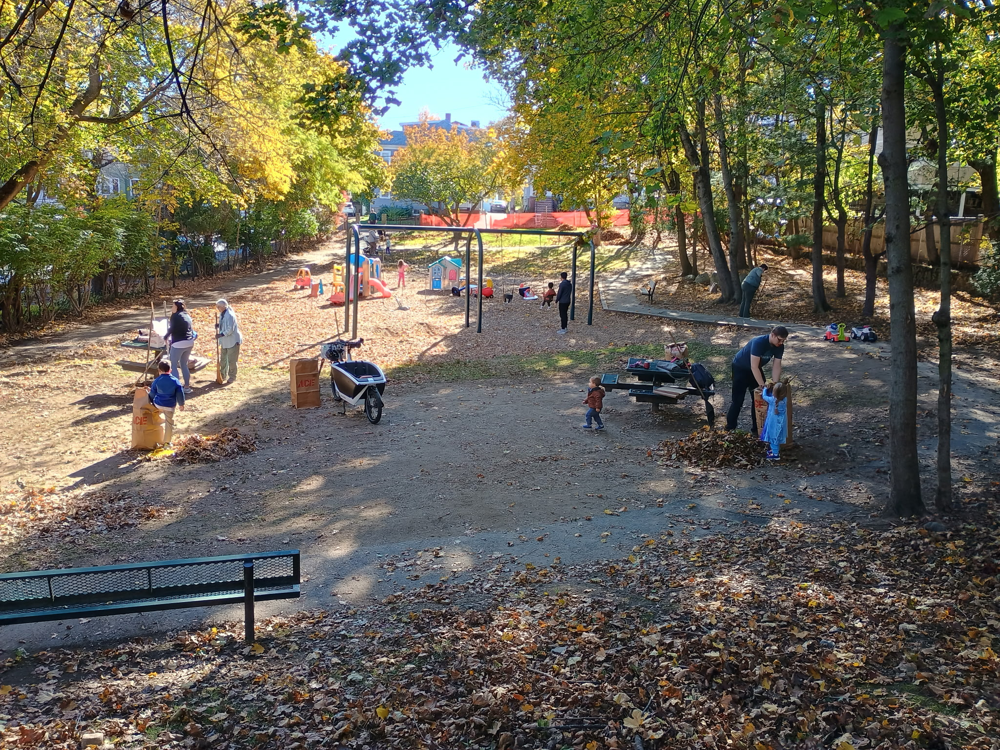
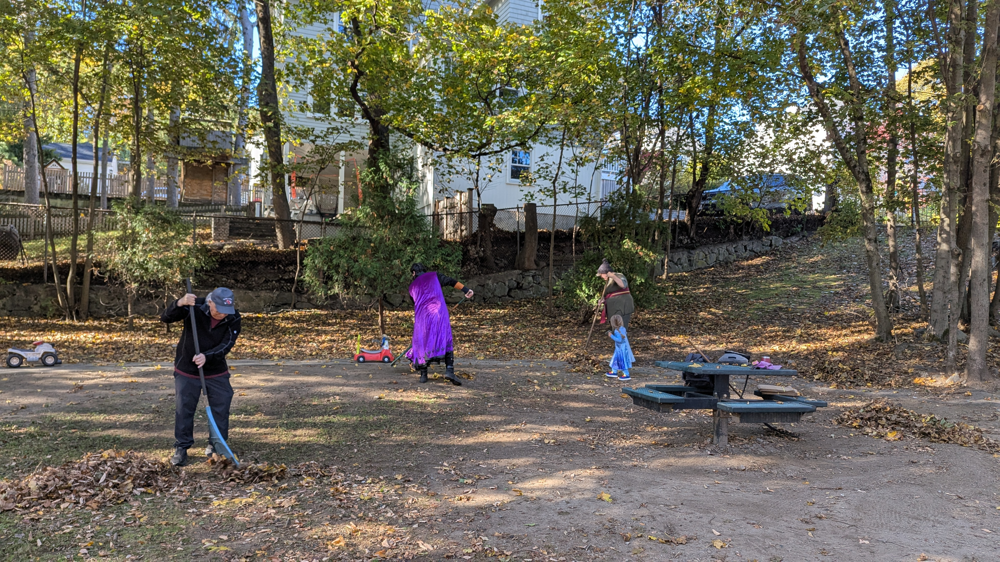

# Feasibility Study Survey

It's finally here! KZLA is seeking input on the future of Cutter / Reinhart Park. You can make your voice heard at this link: [https://tinyurl.com/r28kw5sz](https://tinyurl.com/r28kw5sz)

**The deadline to respond is November 20.**

The Recreation Department and Park and Recreation Commission will be sending out a formal notice on their channels. That message will look like this:

> The Recreation Department and Park and Recreation Commission are inviting you to participate in a community survey to help us better understand how residents use and experience the Cutter/Reinhart Park, and what improvements they would like to see in the future. The survey asks for your thoughts and ideas on a variety of features, including:
>
> * Playground equipment and opportunities for play
> * Seating and places for individuals and families to gather
> * Open grassy areas for informal recreation
> * Spaces that encourage social interaction and community connection
> * Pathways and opportunities for active passage through the park
> * Accessibility and opportunities for people of all ages and abilities
>
> Whether you visit the park regularly, occasionally, or have not used it at all, your input is valuable. We encourage parents, children, older adults, individuals with disabilities, and all members of the community to participate. Your feedback will help us better understand community priorities and inform future planning and decisions about the park.
>
> Thank you for taking the time to share your thoughts and for helping us make our parks and public spaces better for everyone!

[Open Survey](https://tinyurl.com/r28kw5sz){: .btn .btn-primary}

# Leaf Sweeping and Future Meetups

Our Leaf Sweeping Meetup went great; thanks to everyone who participated! We managed to collect over 30 bags of leaves, chat, and enjoy the fall weather together. The kids had a ton of fun as well.

{: style="width:49%"}
{: style="width:49%"}
{: style="width:49%"}
{: style="width:49%"}

We don't have any in-person meetups planned for now. Stay on the lookout for meetups or public input meetings from the Town.

# Select Board Follow-up

We have sent our open letter to and spoken with the Select Board about our concerns. We also spoke at the October 26th Select Board meeting. Special thanks to Lesley Ellis's third grade class, who came out in force to speak on behalf of the monkey bars at Crosby Park.

You can watch the recording of that meeting from ACMi coverage here: [https://youtu.be/s9iyiAkwNzI](https://youtu.be/s9iyiAkwNzI)

We don't know exactly what will come of this; however, the Board voted to refer the matter to the Chair and the Town Manager. We feel this is a broader issue with the management of playgrounds throughout Arlington, and we're hopeful that the Select Board, Town Manager, and Park and Recreation Commission can come to a holistic solution to the problems at hand.

[Watch Oct. 26 Meeting Recording](https://youtu.be/s9iyiAkwNzI){: .btn .btn-primary}

# ACMi Recordings

John Ibsen has partnered with Arlington Community Media to borrow equipment, record, and post the Park & Recreation Commission meetings. Find them on the official ACMi YouTube channel.

[@AcmiTv on YouTube](https://www.youtube.com/@AcmiTv/search?query=Park%20%26%20Recreation%20Commission%20Meeting){: .btn .btn-primary}
